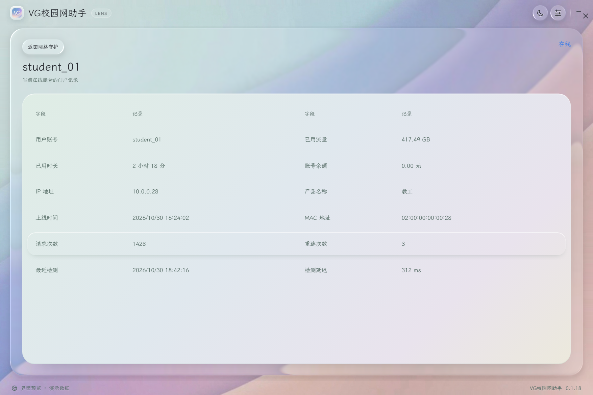

# VG 校园网助手 (VG Campus Wi-Fi Assistant)

面向 Windows 10 / 11 的轻量级 **深澜（Srun）Web Portal 校园网自动认证与断线守护工具**。  
基于 Tauri + React + Rust 构建，在后台以轻量级本地守护进程保持运行，支持 **开机登录 Windows 前自动认证**、**多账号顺序故障转移**、**有线/Wi-Fi 自适应重连** 与 **非校园网静默等待**。

> 当前状态：开发中（`v0.1.18`）。桌面端界面、Rust 认证核心、后台守护进程、本地命名管道 IPC、系统任务安装器与 Windows Toast 通知已完成集成；真实网络环境目前已在 **长安大学深澜门户** 完成验证，其他高校的深澜 Portal 欢迎按下方步骤测试并反馈兼容性。

<p align="center">
  
</p>

---

## 核心特性

- **深澜 Web Portal 原生认证**：Rust 原生实现深澜 XEncode、换表 Base64、HMAC-MD5 与 SHA-1 协议，无需常驻浏览器或 Python 运行环境。
- **自动发现门户**：首次配置支持一键自动探测当前网络下的深澜门户与 `ac_id`；探测失败时可直接粘贴浏览器中的登录页 URL 解析保存。
- **开机即守，脱离界面运行**：开启「网络守护」后注册受保护的系统开机任务（`SYSTEM` 身份运行），在 Windows 登录界面即可完成联网；关闭 GUI 窗口后守护进程仍在后台持续工作。
- **多账号顺序故障转移**：支持添加主账号与多个备用账号、在线一键验证凭据、拖拽/上移下移调整优先级；主账号认证失败时自动按顺序尝试下一个可用账号，手动切号失败时自动尝试回切原账号。
- **有线 & Wi-Fi 断线秒级感知**：监听 Windows 网卡与连接状态变化，网线拔插或 Wi-Fi 重连后立即唤醒检查并恢复登录。
- **非校园网静默休眠**：当电脑连接到家里 Wi-Fi、手机热点等非校园网环境（门户不可达）时，自动进入低频静默复探（30s → 60s → 180s → 300s），**绝不乱试账号、绝不弹出断网误报**；切回校园网后立即自动恢复。
- **本地加密与零遥测**：账号密码仅使用机器级 **Windows DPAPI** 加密保存于本机，认证请求强制要求 HTTPS，日志自动脱敏，不收集任何遥测数据。
- **双主题光学玻璃界面**：基于 Lens Design System，提供「流光（浅色）」与「深海（深色）」双主题及多档窗口比例预设。

---

## 界面预览

| 流光浅色主题（主界面） | 深海深色主题（主界面） |
| :---: | :---: |
|  |  |

| 账号与连接详情 | 校园网门户配置 | 系统设置 |
| :---: | :---: | :---: |
|  |  |  |

---

## 适用范围与限制

- **支持**：基于深澜（Srun）Web Portal（HTTPS）认证的校园网，支持有线网与 Wi-Fi。
- **暂不支持**：802.1X 认证、PPPoE 拨号、图形验证码、短信验证码，以及多学校门户配置文件并存。
- **合规声明**：本项目仅用于自动完成常规校园网门户认证与断线重连，**不会绕过**学校计费规则、在线设备数量限制或网络访问策略。使用本项目产生的网络行为仍需遵守所在学校的网络管理规定。

---

## 快速上手（使用步骤）

### 第一步：下载与安装

1. 前往本仓库的 [Releases](https://github.com/s0ng1v/vg-srun-campus-wifi-assistant/releases) 页面下载最新安装包（也可下载便携压缩包与 `SHA256SUMS.txt` 校验）：
   ```text
   vg-campus-wifi-assistant_<version>_x64-setup.exe
   ```
2. 运行安装程序（NSIS 安装包），按机器安装至 `C:\Program Files\VG校园网助手`，安装过程中会自动附带守护进程、通知组件与系统配置 helper。

### 第二步：配置校园网门户

1. 确保电脑当前已连接到校园网（有线网口或校园 Wi-Fi）。
2. 打开 **VG 校园网助手**，点击右上角 **设置（⚙）→ 配置门户**。
3. 点击 **自动识别校园网门户**；如果当前已在线未触发跳转，或自动识别未能命中，请用浏览器打开任意网页触发学校认证页，复制完整登录页地址（例如 `https://portal.example.edu.cn/srun_portal_pc?ac_id=5`）粘贴并保存。

### 第三步：添加与验证登录账号

1. 在主界面右侧 **登录账号** 面板点击 **＋ 添加账号**，输入校园网账号和密码并保存。
2. 如有多个备用账号，可继续添加，并通过每行右侧 `···` 菜单中的 **上移一行 / 下移一行** 调整尝试顺序。
3. 对于暂未使用的备用账号，可点击 **验证** 按钮测试凭据有效性（程序会短暂切换验证并自动切回当前在线账号）。

### 第四步：开启「网络守护」

1. 打开主界面顶部的 **网络守护** 开关。
2. 首次开启时会请求一次管理员权限（UAC），由 `vg-campus-setup.exe` 完成以下安全部署：
   - 将主程序、守护进程与通知 helper 复制到受保护目录 `C:\Program Files\VGCampusWifiAssistant\app-<version>\`；
   - 注册开机以 `SYSTEM` 身份运行的守护任务与按需触发的用户桌面 Toast 通知任务；
   - 注册通知点击唤醒窗口使用的 URI 协议（`vg-campus-wifi-assistant://`）。
3. 开启后即可直接关闭应用窗口——守护进程将继续在后台独立运行，在断线或重启电脑停留在 Windows 登录界面时自动完成联网。

### 卸载说明

- 通过 Windows「应用和功能」或安装目录下的卸载程序卸载时，系统任务与 URI 协议会自动移除；
- 运行时配置、加密凭据与脱敏日志保存在 `C:\ProgramData\VGCampusWifiAssistant\`，卸载时默认保留以便重装恢复，如需彻底清理可手动删除该目录。

---

## 架构与安全设计

项目由 4 个协同工作的原生可执行文件组成（详见 [docs/ARCHITECTURE.md](docs/ARCHITECTURE.md)）：

| 可执行文件 | 职责说明 |
| --- | --- |
| `vg-campus-assistant.exe` | Tauri 桌面 GUI，仅负责交互与状态展示，不直接持有明文密码 |
| `vg-campus-daemon.exe` | 无界面后台守护进程，负责网卡监听、状态机、探测与认证 |
| `vg-campus-notifier.exe` | 短生命周期 Windows Toast 通知 helper，仅在用户桌面按需触发 |
| `vg-campus-setup.exe` | 安装、升级与卸载时注册/清理受保护目录及系统计划任务 |

安全边界：
- **最小权限与受保护路径**：`SYSTEM` 计划任务仅执行受保护 `Program Files` 目录下的二进制文件，避免用户可写目录提权风险。
- **本地凭据加密**：账号密码通过机器级 Windows DPAPI 加密存储在 `C:\ProgramData\VGCampusWifiAssistant\credentials.dat`，GUI 侧无法读取明文密码。
- **IPC 访问控制**：本地命名管道通过所有者 SID、`SYSTEM` 与管理员 ACL 限制访问。
- **强制 HTTPS 与脱敏日志**：拒绝向非 HTTPS 门户提交凭据；诊断日志自动剔除密码、challenge 与完整认证 URL。

---

## 从源码构建与开发

### 环境要求

- **操作系统**：Windows 10 / 11
- **Node.js**：`20.19+`（CI 使用 Node 22）
- **Rust**：`1.90+`（随附 `rust-toolchain.toml`）
- **运行时**：Microsoft Edge WebView2（Windows 11 默认自带）

### 本地开发与调试

```powershell
# 1. 克隆仓库
git clone https://github.com/s0ng1v/vg-srun-campus-wifi-assistant.git
cd vg-srun-campus-wifi-assistant

# 2. 安装前端依赖
npm install

# 3. 启动桌面端开发模式（会自动编译 daemon / notifier / setup sidecars）
npm run dev
```

如果仅需在浏览器中预览前端界面（无真实守护进程，自动加载内置演示数据）：

```powershell
npm run dev:renderer
```

### 生产构建

```powershell
npm ci
npm run build
```

构建产物位置：
- 独立可执行文件（`target/release/`）：
  - `vg-campus-assistant.exe`
  - `vg-campus-daemon.exe`
  - `vg-campus-notifier.exe`
  - `vg-campus-setup.exe`
- 单文件 NSIS 安装包：
  - `target/release/bundle/nsis/VG校园网助手_<version>_x64-setup.exe`

### 质量校验

```powershell
npm run check:lens
npm run build:renderer
cargo fmt --all -- --check
cargo test --workspace --locked
cargo clippy --workspace --all-targets --locked -- -D warnings
```

---

## 文档与贡献

- [架构说明](docs/ARCHITECTURE.md)
- [验收清单](docs/ACCEPTANCE.md)（包含真机网络验收步骤与发布前检查项）
- [开发路线](docs/ROADMAP.md)
- [贡献指南](CONTRIBUTING.md)
- [安全政策](SECURITY.md)

## 许可证

本项目基于 [MIT License](LICENSE) 开源。第三方组件许可详见 [THIRD_PARTY_NOTICES.md](THIRD_PARTY_NOTICES.md) 与 [licenses/](licenses/)。
