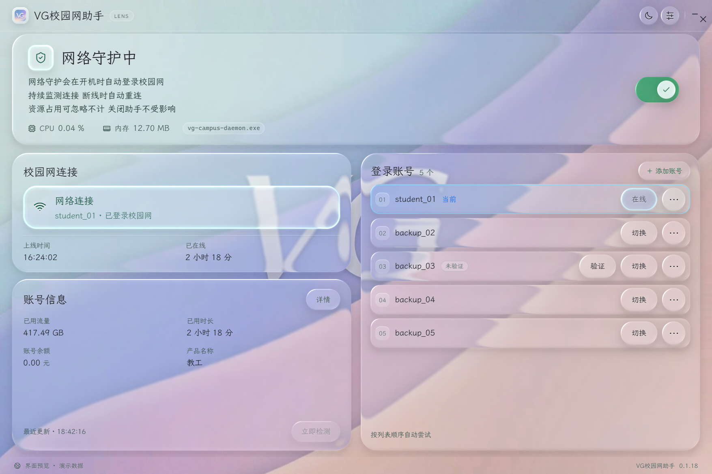
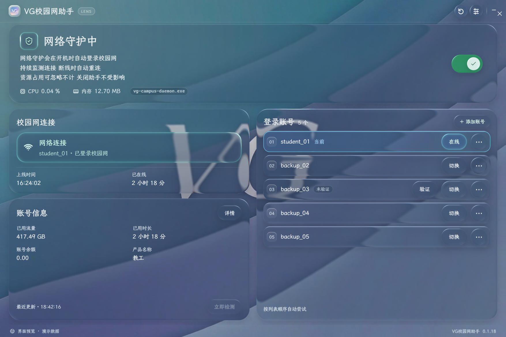
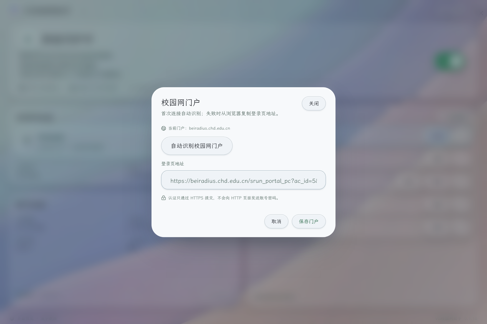
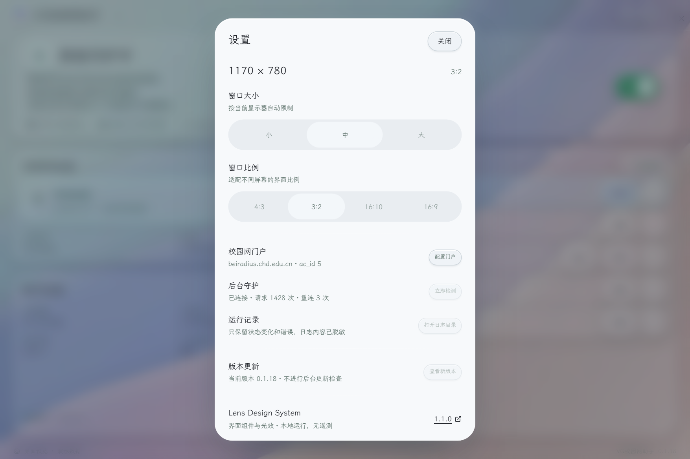
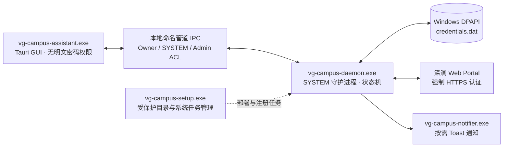

<div align="center">


# VG 校园网助手

**轻量、安全、开机即守的 Windows 深澜（Srun）Web Portal 自动认证与断线守护工具**

[](https://github.com/s0ng1v/vg-srun-campus-wifi-assistant/releases)
[](https://github.com/s0ng1v/vg-srun-campus-wifi-assistant/actions/workflows/ci.yml)
[](https://github.com/s0ng1v/vg-srun-campus-wifi-assistant/releases)

[](LICENSE)


[⬇️ 下载最新版](https://github.com/s0ng1v/vg-srun-campus-wifi-assistant/releases/latest) · [✨ 核心特性](#-核心特性) · [🖼️ 界面预览](#-界面预览) · [🚀 快速上手](#-快速上手) · [🛡️ 架构与安全](#-架构与安全) · [🛠️ 源码构建](#-从源码构建)

<br />


</div>

https://github.com/user-attachments/assets/8415486b-a3f3-4cbf-9595-2913c0dfdfe4

---

> [!NOTE]
> **当前进度（`v0.1.18`）**：桌面端界面、Rust 认证核心、独立后台守护进程、本地命名管道 IPC、系统计划任务安装器与 Windows Toast 通知已全部集成；真实网络目前已在 **长安大学深澜门户** 完成验证，欢迎其他高校用户按下方步骤测试并提交兼容反馈。

> [!IMPORTANT]
> **适用范围与合规说明**  
> - **支持**：基于深澜（Srun）Web Portal（HTTPS）的校园网认证，同时支持有线网与 Wi-Fi。  
> - **暂不支持**：802.1X、PPPoE 拨号、图形验证码、短信验证码，以及多学校门户配置文件并存。  
> - **合规声明**：本项目仅用于常规自动认证与断线重连，**不会绕过**学校计费规则、在线设备数量限制或网络访问策略，使用行为仍受所在学校网络管理规定约束。

---

## ✨ 核心特性

<table>
  <tr>
    <td width="50%">
      <h4>⚡ 原生深澜协议栈</h4>
      <p>Rust 原生实现深澜 XEncode、换表 Base64、HMAC-MD5 与 SHA-1 算法，无需常驻浏览器或 Python 运行时，资源占用极低。</p>
    </td>
    <td width="50%">
      <h4>🔄 开机即守 · 脱离界面运行</h4>
      <p>注册受保护的 <code>SYSTEM</code> 开机计划任务，在进入 Windows 桌面之前即可完成联网；关闭 GUI 窗口后守护进程仍在后台持续工作。</p>
    </td>
  </tr>
  <tr>
    <td>
      <h4>🔀 多账号顺序故障转移</h4>
      <p>支持维护主备多个账号、一键在线验证凭据、上下调整优先级；主账号异常时自动尝试下一账号，手动切号失败自动尝试回切。</p>
    </td>
    <td>
      <h4>🔌 有线 &amp; Wi-Fi 秒级自适应</h4>
      <p>监听 Windows 网卡与网络连接变化事件，插拔网线或切换 Wi-Fi 后立即唤醒状态机检测并恢复登录。</p>
    </td>
  </tr>
  <tr>
    <td>
      <h4>🌙 非校园网静默休眠</h4>
      <p>当连接家庭 Wi-Fi、手机热点等非校园网（门户不可达）时，自动进入低频复探（30s → 60s → 180s → 300s），<b>不乱试账号、不弹误报</b>。</p>
    </td>
    <td>
      <h4>🔐 DPAPI 加密与零遥测</h4>
      <p>凭据通过机器级 <b>Windows DPAPI</b> 加密存放在本机，强制 HTTPS 提交认证，日志自动脱敏，无任何后台遥测或联网上报。</p>
    </td>
  </tr>
</table>

---

## 🖼️ 界面预览

基于 **Lens Design System** 打造的双主题光学玻璃界面，支持浅色「流光」与深色「深海」主题自由切换：

| ☀️ 流光浅色主题（主界面） | 🌙 深海深色主题（主界面） |
| :---: | :---: |
|  |  |

| 📊 账号与连接详情 | 🌐 校园网门户配置 | ⚙️ 系统设置 |
| :---: | :---: | :---: |
|  |  |  |

---

## 🚀 快速上手

### 1️⃣ 下载与安装

前往 [**Releases 页面**](https://github.com/s0ng1v/vg-srun-campus-wifi-assistant/releases/latest) 下载最新版安装程序（也可下载便携压缩包与 `SHA256SUMS.txt` 校验完整性）：

```text
vg-campus-wifi-assistant_<version>_x64-setup.exe
```

运行安装向导（NSIS 安装包），程序默认安装至 `C:\Program Files\VG校园网助手`，并自动打包守护进程、通知组件与系统安装器。

### 2️⃣ 配置校园网门户

1. 确保电脑已接入校园网（有线网口或校园 Wi-Fi）。
2. 打开 **VG 校园网助手**，点击右上角 **设置（⚙）→ 配置门户**。
3. 点击 **自动识别校园网门户**；若当前已在线未发生跳转或自动识别未命中，可在浏览器打开任意网页触发学校认证页，复制完整登录页 URL（例如 `https://portal.example.edu.cn/srun_portal_pc?ac_id=5`）粘贴并保存。

### 3️⃣ 添加与验证登录账号

1. 在主界面右侧 **登录账号** 面板点击 **＋ 添加账号**，填写校园网账号与密码并保存。
2. 如有多个备用账号，可继续添加，并通过每行右侧 `···` 菜单中的 **上移一行 / 下移一行** 调整故障转移顺序。
3. 未验证的备用账号可点击 **验证** 按钮测试凭据有效性（程序会短暂切换测试，并在完成后自动切回当前在线账号）。

### 4️⃣ 开启「网络守护」

1. 打开主界面顶部的 **网络守护** 开关。
2. 首次开启会弹出一次管理员权限（UAC）请求，由 `vg-campus-setup.exe` 完成受保护部署：
   - 将主程序、守护进程与通知 helper 复制到受保护目录 `C:\Program Files\VGCampusWifiAssistant\app-<version>\`；
   - 注册开机以 `SYSTEM` 身份运行的守护任务与按需触发的用户桌面 Toast 通知任务；
   - 注册通知点击唤醒窗口使用的 URI 协议（`vg-campus-wifi-assistant://`）。
3. 开启后即可直接关闭窗口——守护进程将在后台独立驻留，断线重连或重启电脑停留在 Windows 登录界面时均可自动完成认证。

> [!TIP]
> **关于卸载与数据清理**：通过 Windows「应用和功能」卸载时，系统计划任务与 URI 协议会自动移除；运行时配置、加密凭据与脱敏日志保存在 `C:\ProgramData\VGCampusWifiAssistant\`，卸载时默认保留以便重装恢复，如需彻底清除可手动删除该目录。

---

## 🛡️ 架构与安全

项目由 4 个职责隔离的原生可执行文件协同工作（完整设计见 [架构说明](docs/ARCHITECTURE.md)）：



| 组件 | 职责说明 |
| --- | --- |
| `vg-campus-assistant.exe` | Tauri 桌面界面，仅负责状态展示与指令下发，无法读取已保存的明文密码 |
| `vg-campus-daemon.exe` | 无界面后台守护进程，负责网卡事件监听、状态机调度、连通性探针与深澜认证 |
| `vg-campus-notifier.exe` | 短生命周期 Windows Toast 通知 helper，仅接收事件码并在用户桌面弹窗后退出 |
| `vg-campus-setup.exe` | 安装、覆盖升级与卸载时管理受保护程序目录、计划任务与 URI 协议 |

**本地安全边界**：
- **防提权路径隔离**：`SYSTEM` 计划任务只指向 `Program Files` 受保护目录中的二进制文件，不从用户可写目录加载程序。
- **凭据强加密**：账号密码使用机器级 Windows DPAPI 加密，仅 `SYSTEM`、管理员与所有者可读。
- **通道与协议约束**：本地命名管道强制校验访问控制列表（ACL）；对外认证严格拒绝非 HTTPS 门户；诊断日志自动剔除密码、challenge 与完整认证 URL。

---

## 🛠️ 从源码构建

### 环境要求

- **操作系统**：Windows 10 / 11
- **Node.js**：`20.19+`（CI 使用 Node 22）
- **Rust**：`1.90+`（随附 [rust-toolchain.toml](rust-toolchain.toml)）
- **WebView 运行时**：Microsoft Edge WebView2（Windows 11 默认内置）

### 本地开发与构建

```powershell
# 1. 克隆仓库
git clone https://github.com/s0ng1v/vg-srun-campus-wifi-assistant.git
cd vg-srun-campus-wifi-assistant

# 2. 安装前端依赖
npm install

# 3. 启动完整桌面端开发模式（自动编译 daemon / notifier / setup sidecars）
npm run dev

# 或仅启动浏览器界面预览（自动使用内置演示数据，无需守护进程）
npm run dev:renderer
```

生产构建（生成可执行文件与 NSIS 安装包）：

```powershell
npm ci
npm run build
```

<details>
<summary>📦 查看构建产物路径与质量校验命令</summary>

#### 生产构建产物
- 独立可执行文件（`target/release/`）：
  - `vg-campus-assistant.exe`
  - `vg-campus-daemon.exe`
  - `vg-campus-notifier.exe`
  - `vg-campus-setup.exe`
- 单文件 NSIS 安装包：
  - `target/release/bundle/nsis/VG校园网助手_<version>_x64-setup.exe`

#### CI 质量校验命令
```powershell
npm run check:lens
npm run build:renderer
cargo fmt --all -- --check
cargo test --workspace --locked
cargo clippy --workspace --all-targets --locked -- -D warnings
```

</details>

---

## 📚 相关文档

- [架构说明](docs/ARCHITECTURE.md) — 进程模型、网络状态机与本地安全边界
- [验收清单](docs/ACCEPTANCE.md) — 自动化测试覆盖项、真机网络验收与发布检查清单
- [开发路线](docs/ROADMAP.md) — M0 ~ M4 里程碑规划与进度
- [贡献指南](CONTRIBUTING.md) — 开发规范、协议测试规则与提交格式
- [安全政策](SECURITY.md) — 漏洞反馈渠道与凭据处理规范

## 📄 开源许可

本项目基于 [MIT License](LICENSE) 开源。第三方组件许可详见 [THIRD_PARTY_NOTICES.md](THIRD_PARTY_NOTICES.md) 与 [licenses/](licenses/)。
